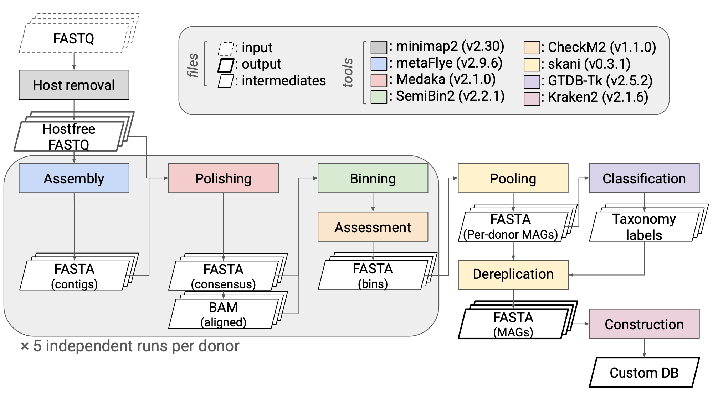

# Custom Database Generation
> Long-read metagenomic assembly, MAG recovery, and custom Kraken2 database construction

## Rationale

Human microbiota-associated mouse models require accurate measurement of microbial engraftment. However, standard taxonomic databases contain many irrelevant taxa, which increases the chance of misclassification in germ-free mice colonized with human samples.

By generating assemblies and MAGs directly from donor metagenomes:
  * The search space is narrowed to taxa that are biologically expected
  * Detection sensitivity increases
  * False positives decrease
  * Reproducibility is enhanced

Using donor-derived metagenomes reduces the search space to biologically relevant taxa and avoids false positives that arise from using large, generic reference databases.

## Workflows

**Input**: FASTQ files from the [Preprocessing](./Preprocessing.md) module: the length-filtered reads of Step 09, or the reads of Step 05 if no length filter is applied.

1.  **Host removal**: Remove mouse and human reads. Host reads must be removed before assembly; otherwise mouse and human sequences enter the assemblies.
2.  **Assembly**: Assemble the host-free reads with metaFlye, five independent times per sample.
3.  **Polishing**: Polish each assembly with Medaka.
4.  **Binning**: Recover bins with SemiBin2.
5.  **Quality assessment**: Keep high-quality bins (CheckM2).
6.  **Pooling**: Keep species recovered reproducibly across the five runs.
7.  **Taxonomic classification**: Assign GTDB taxonomy to the pooled MAGs.
8.  **Dereplication**: Collapse MAGs shared across samples into one MAG per species.
9.  **Database construction**: Build a custom Kraken2 database from the MAGs themselves.

### Why five runs?
metaFlye has no random-seed option, and repeated assemblies of the same reads give slightly different contigs and therefore different bins. Running the whole assembly-to-binning workflow five times and keeping only species found in at least three runs removes genomes that depend on a single assembly.

### Environment setup
Before running the pipeline, set the following environment variables to define input locations, output directories, and software paths.

```bash
# Define base folders
export FILTERED_FOLDER=/path/to/filtered   # FASTQ files from Preprocessing (Step 09, or Step 05 without length filtering)
export HOST_REF=/path/to/host_reference     # Combined host reference and minimap2 index
export HOSTFREE_FOLDER=/path/to/hostfree    # Host-free FASTQ files (Step 01)
export ASSEMBLY_FOLDER=/path/to/assembly
export MEDAKA_FOLDER=/path/to/medaka
export BIN_FOLDER=/path/to/bins
export CHECKM2_FOLDER=/path/to/checkm2
export POOL_FOLDER=/path/to/pooling
export GTDBTK_FOLDER=/path/to/gtdbtk
export DEREP_FOLDER=/path/to/dereplication
export MAG_FOLDER=/path/to/mags
export REF_FOLDER=/path/to/references       # CheckM2 and GTDB-Tk databases
export CUSTOMDB_FOLDER=/path/to/custom_db
```

Make sure all tools are installed and available in your system `PATH`, or update the variables to their absolute paths.

### Dependencies

Install or load the following tools before execution:

| Tool | Version | Purpose | Reference |
|------|---------|----------|------------|
| [minimap2](https://github.com/lh3/minimap2) | 2.30 | Alignment of reads to the host genomes | Heng Li |
| [SAMTools](http://www.htslib.org/) | 1.16.1 | Extraction of unmapped (host-free) reads | Heng Li et al. |
| [metaFlye](https://github.com/mikolmogorov/Flye) | 2.9.6 | Long-read metagenomic assembly | Kolmogorov et al. |
| [Medaka](https://github.com/nanoporetech/medaka) | 2.1.0 | ONT assembly polishing (consensus correction) | Oxford Nanopore Technologies |
| [SemiBin2](https://github.com/BigDataBiology/SemiBin) | 2.2.1 | Metagenomic binning using machine learning–based clustering | Pan et al. |
| [CheckM2](https://github.com/chklovski/CheckM2) | 1.1.0 | MAG quality assessment (completeness and contamination) | Chklovski et al. |
| [skani](https://github.com/bluenote-1577/skani) | 0.3.1 | Average nucleotide identity (ANI) between genomes | Shaw & Yu |
| [GTDB-Tk](https://github.com/Ecogenomics/GTDBTk) | 2.5.2 (GTDB release 226) | Taxonomic classification of MAGs using the GTDB database | Chaumeil et al. |
| [Kraken2](https://github.com/DerrickWood/kraken2) | 2.1.6 | High-throughput taxonomic classification of sequencing reads | Wood et al. |

**Random seeds.** minimap2 breaks ties between equally best hits by hashing the read name with a fixed seed (`--seed`, default 11), so host removal is deterministic. SAMTools, metaFlye, Medaka, CheckM2, skani, GTDB-Tk and Kraken2 have no random-seed option. SemiBin2 accepts `--random-seed`, but it has no effect when a pre-trained model is used (`--environment`).

### Example directory structure
```bash
├── filtered/               # FASTQ files from Preprocessing (input)
├── host_reference/         # Combined host genome and minimap2 index
├── hostfree/               # Host-free FASTQ files
├── assembly/               # metaFlye assemblies, <sample>_run<N>/
├── medaka/                 # Polished assemblies and read alignments, <sample>_run<N>/
├── bins/                   # SemiBin2 bins, <sample>_run<N>/
├── checkm2/                # CheckM2 outputs, <sample>_run<N>/
├── pooling/                # MAGs reproducible across runs, <sample>/
├── gtdbtk/                 # GTDB-Tk taxonomy outputs, <sample>/
├── dereplication/          # MAGs dereplicated across samples
├── mags/                   # Final MAGs, one per species
└── custom_db/              # Final Kraken2 custom database
```

### Schematic overview




### Pipeline steps
Step 01 is run once per sample. Steps 02–05 are run five times per sample (`run1`–`run5`); the example shows sample F0, run 1.

#### Step 01. Host removal with minimap2

In human microbiota-associated mouse models, reads from the mouse host (and from human contamination) should be removed before assembly and taxonomic classification. Otherwise, host reads enter the assemblies and compete for _k_-mer assignments during classification. Here, the GENCODE primary assemblies of mouse (GRCm39) and human (GRCh38) are combined, with sequence names prefixed by species so that host reads can be counted per species, and any read with a primary alignment to either genome is removed.

**Keep the read headers.** Dorado writes basecalling information as tags in each FASTQ header, and Medaka 2.1.0 reads these tags to check that its model matches the basecaller. Use `minimap2 -y` to copy the tags into the alignment and `samtools fastq -T '*'` to write them back. Without both options the host-free reads have no tags, and Medaka stops with `TypeError: argument of type 'NoneType' is not iterable`.

```bash
# Build the combined host reference once
mkdir -p $HOST_REF
sed 's/^>/>mm_/' GRCm39.primary_assembly.genome.fa >  $HOST_REF/GRCm39_GRCh38.fa
sed 's/^>/>hs_/' GRCh38.primary_assembly.genome.fa >> $HOST_REF/GRCm39_GRCh38.fa
minimap2 -x map-ont -d $HOST_REF/GRCm39_GRCh38.mmi $HOST_REF/GRCm39_GRCh38.fa

# Align each sample and keep the unmapped (host-free) reads, with header tags
mkdir -p $HOSTFREE_FOLDER
minimap2 -y -ax map-ont --secondary=no $HOST_REF/GRCm39_GRCh38.mmi $FILTERED_FOLDER/F0.fastq.gz | samtools view -b -o $HOSTFREE_FOLDER/F0.host.bam -
samtools fastq -f 4 -T '*' $HOSTFREE_FOLDER/F0.host.bam | gzip > $HOSTFREE_FOLDER/F0.fastq.gz

# Count host reads per species (primary alignments only)
samtools view -F 0x904 $HOSTFREE_FOLDER/F0.host.bam | cut -f3 | grep -c '^mm_'   # mouse
samtools view -F 0x904 $HOSTFREE_FOLDER/F0.host.bam | cut -f3 | grep -c '^hs_'   # human
```

#### Step 02. Assembly with metaFlye
```bash
flye --nano-hq $HOSTFREE_FOLDER/F0.fastq.gz --out-dir $ASSEMBLY_FOLDER/F0_run1 --meta
```

#### Step 03. Polishing with Medaka

Dorado and Medaka are both developed by Oxford Nanopore Technologies; however, their model naming conventions are not fully consistent across applications. For example, the same model may appear as:
  * dna_r10.4.1_e8.2_400bps_sup@v5.2.0
  * r1041_e82_400bps_sup_v5.2.0

Medaka reads the Dorado tags in the FASTQ headers to check the model, so the input reads must keep their header tags (see Step 01).

```bash
medaka_consensus -i $HOSTFREE_FOLDER/F0.fastq.gz -d $ASSEMBLY_FOLDER/F0_run1/assembly.fasta -o $MEDAKA_FOLDER/F0_run1 -m r1041_e82_400bps_sup_v5.2.0
```

#### Step 04. Binning with SemiBin2

SemiBin2 uses the polished contigs and the read alignments that Medaka writes (`calls_to_draft.bam`) for contig coverage.

```bash
SemiBin2 single_easy_bin -i $MEDAKA_FOLDER/F0_run1/consensus.fasta -b $MEDAKA_FOLDER/F0_run1/calls_to_draft.bam -o $BIN_FOLDER/F0_run1 --environment human_gut --sequencing-type long_read
```

#### Step 05. Quality assessment with CheckM2

Bins with completeness ≥ 90% and contamination < 5% are classed as high quality (MIMAG high-quality draft criteria; Bowers et al. 2017).

```bash
export CHECKM2DB="$REF_FOLDER/uniref100.KO.1.dmnd"
checkm2 predict -i $BIN_FOLDER/F0_run1/output_bins --output_directory $CHECKM2_FOLDER/F0_run1 -x fa.gz
```

#### Step 06. Pooling the five runs

For each sample, the high-quality bins of all five runs are compared pairwise with skani. Bins sharing ≥ 95% ANI (the operational species boundary; Jain et al. 2018) are linked into species groups by single linkage, with no minimum aligned fraction. A group is kept if it was recovered in at least three of the five runs, and its representative is the bin with the highest completeness − 5 × contamination (the dRep scoring weight; Olm et al. 2017).

```bash
# hq_bins.txt: paths of the high-quality bins (Step 05) from run1-run5 of sample F0
skani triangle -l $POOL_FOLDER/F0/hq_bins.txt -E -o $POOL_FOLDER/F0/skani_edges.tsv
# Group bins at ANI >= 95 (single linkage), keep groups found in >= 3 of 5 runs,
# and copy each group's representative to $POOL_FOLDER/F0/<MAG>.fa.gz
```

#### Step 07. Taxonomic classification with GTDB-Tk

```bash
export GTDBTK_DATA_PATH=$REF_FOLDER/gtdbtk/release226
gtdbtk classify_wf --genome_dir $POOL_FOLDER/F0 --out_dir $GTDBTK_FOLDER/F0 --extension fa.gz
```

#### Step 08. Dereplication across samples

The pooled MAGs of all samples are compared with the same rule (skani ANI ≥ 95%, single linkage). Single linkage can join closely related species whose genomes share ≥ 95% ANI, so any group holding more than one GTDB-Tk species is split by species. Each final MAG therefore corresponds to exactly one species; the representative is again the genome with the highest completeness − 5 × contamination.

```bash
# all_mags.txt: paths of the pooled MAGs (Step 06) of every sample
skani triangle -l $DEREP_FOLDER/all_mags.txt -E -o $DEREP_FOLDER/skani_edges.tsv
# Group at ANI >= 95 (single linkage), split groups by GTDB-Tk species (Step 07),
# and write one representative per species to $MAG_FOLDER/MAGnnn.fa
```

#### Step 09. Build the custom Kraken2 database

The database is built from the MAGs themselves; no reference genomes are downloaded. A custom taxonomy is written from the GTDB lineages of the MAGs (domain to species): one node per rank, and one species node per MAG. MAGs without a species-level GTDB-Tk name get their own species node under their genus.

1. Write `names.dmp` and `nodes.dmp` for the custom taxonomy into `$CUSTOMDB_FOLDER/myDB/taxonomy/`.
2. Add the MAG's taxonomy ID to every contig header:

        >MAG001_c001|kraken:taxid|XXXXXX

3. Write `genome_stats.txt` for BASEN: one line per MAG, `taxid<TAB>total genome length in bp`.
4. Build the database. No decoy or host genomes are added, because host reads are removed before classification.

```bash
cd $CUSTOMDB_FOLDER
for f in MAG*.fa; do k2 add-to-library --db myDB --file $f; done
k2 build --db myDB --kmer-len 35 --minimizer-len 31
```

---
