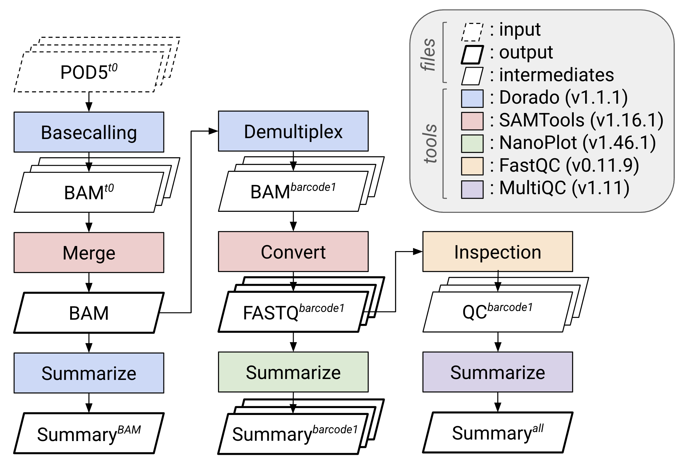

# Preprocessing
> Advancing the preprocessing of Nanopore sequencing data

## Rationale

_MinKNOW_ from Oxford Nanopore frequently crashes and does not provide the most up-to-date _Dorado_ basecaller. Therefore, establishing an external computational environment is recommended for scalability and reproducibility. The _Dorado_ version reported in the Web summary from MinKNOW is the _Dorado Basecall Server_ version, which is misleading. In addition, the latest _Dorado_ release (v1.X.X), following the major update, provides an expanded quality score range based on improved signal-to-sequence predictors.

## Workflows

The pipeline performs the following tasks:

1. **Basecalling** of raw POD5 files using Dorado.  
2. **Merging** individual BAM files into a single dataset.  
3. **Demultiplexing** by barcode.  
4. **Generating sequencing summaries** for merged and demultiplexed BAM files.  
5. **Converting BAM to FASTQ** format.  
6. **Computing quality statistics** using NanoPlot and FastQC.  
7. **Aggregating reports** with MultiQC.
8. **Filtering and trimming reads** by length (optional, data-dependent).

### Environment setup

Before running the pipeline, set the following environment variables to define input locations, output directories, and software paths.

```bash
# Define tool locations
export DORADO=/path/to/dorado           # Path to Dorado executable directory

# Define base folders
export POD5_FOLDER=/path/to/pod5_files  # Directory containing input POD5 files
export BAM_FOLDER=/path/to/bam_output   # Directory for basecalled BAM files
export DEMUX_FOLDER=/path/to/demuxed    # Directory for demultiplexed BAMs
export SUMMARY_FOLDER=/path/to/summary  # Directory for Dorado summary outputs
export FASTQ_FOLDER=/path/to/fastq      # Directory for FASTQ output files
export STAT_FOLDER=/path/to/nanoplot    # Directory for NanoPlot statistics
export FASTQC_FOLDER=/path/to/fastqc    # Directory for FastQC results
export MULTIQC_FOLDER=/path/to/multiqc  # Directory for aggregated MultiQC report
export FILTERED_FOLDER=/path/to/filtered # Directory for length-filtered FASTQ files

# Define sequencing kit information (update accordingly)
export KIT_INFO="SQK-NBD-24"
export PLATE="Plate01"
```

Make sure all tools are installed and available in your system `PATH`, or update the variables to their absolute paths.


### Dependencies

Install or load the following tools before execution:

| Tool | Version | Purpose | Reference |
|------|---------|----------|------------|
| [Dorado](https://github.com/nanoporetech/dorado) | 1.1.1 | Basecalling, demultiplexing, and summarization | Oxford Nanopore Technologies |
| [SAMTools](http://www.htslib.org/) | 1.16.1 | BAM file manipulation and FASTQ conversion | Heng Li et al. |
| [NanoPlot](https://github.com/wdecoster/NanoPlot) | 1.46.1 | Read length and quality visualization | Wouter De Coster |
| [FastQC](https://www.bioinformatics.babraham.ac.uk/projects/fastqc/) | 0.11.9 | Per-base quality assessment | Babraham Bioinformatics |
| [MultiQC](https://multiqc.info/) | 1.11 | Aggregation of QC reports | Phil Ewels et al. |
| [cutadapt](https://cutadapt.readthedocs.io/) | 4.0 | Trimming reads to a specified length | Martin |

### Example directory structure

```bash
├── pod5/             # Raw input POD5 files
├── bam/              # Basecalled BAM outputs
├── demux/            # Demultiplexed BAM files
├── fastq/            # FASTQ outputs
├── summary/          # Dorado summary files
├── stats/            # NanoPlot results
├── fastqc/           # FastQC reports
├── multiqc/          # MultiQC aggregated reports
└── filtered/         # Length-filtered FASTQ files (Step 09)
```

### Schematic overview
  

### Pipeline steps
#### Step 01. Basecalling with Dorado

```bash
mkdir -p $BAM_FOLDER
$DORADO/dorado basecaller sup $POD5_FOLDER/ONT_5e22_a7b0_1.pod5 --kit-name $KIT_INFO --barcode-both-ends > $BAM_FOLDER/Unaligned_1.bam
$DORADO/dorado basecaller sup $POD5_FOLDER/ONT_5e22_a7b0_2.pod5 --kit-name $KIT_INFO --barcode-both-ends > $BAM_FOLDER/Unaligned_2.bam
```

#### Step 02. Merge BAM files

```bash
samtools merge $BAM_FOLDER/Merged.bam $BAM_FOLDER/*.bam
```

#### Step 03. Demultiplex reads by barcode

```bash
mkdir -p $DEMUX_FOLDER
$DORADO/dorado demux --output-dir $DEMUX_FOLDER --no-classify $BAM_FOLDER/Merged.bam
```

#### Step 04. Generate sequencing summary

```bash
mkdir -p $SUMMARY_FOLDER
$DORADO/dorado summary $BAM_FOLDER/Merged.bam > $SUMMARY_FOLDER/$PLATE.tsv
```

#### Step 05. Convert BAM to FASTQ

```bash
mkdir -p $FASTQ_FOLDER
samtools fastq -T"*" $DEMUX_FOLDER/ONT_5e22_a7b0_1_barcode96.bam | gzip > $FASTQ_FOLDER/barcode96.fastq.gz
```

#### Step 06. Summarize read quality using NanoPlot

```bash
mkdir -p $STAT_FOLDER
NanoPlot --fastq $FASTQ_FOLDER/barcode96.fastq.gz --no_static --tsv_stats --raw --outdir $STAT_FOLDER/barcode96
```

#### Step 07. Evaluate per-base quality using FastQC

```bash
mkdir -p $FASTQC_FOLDER/barcode96
fastqc -o $FASTQC_FOLDER/barcode96 --extract -f fastq $FASTQ_FOLDER/barcode96.fastq.gz
```

#### Step 08. Aggregate reports with MultiQC

```bash
mkdir -p $MULTIQC_FOLDER
multiqc -z -o $MULTIQC_FOLDER $FASTQC_FOLDER
```

#### Step 09. Filter and trim reads by length (optional)

This step depends on the data: if read quality holds across all read lengths, no length filter is needed.

The selection of filtering thresholds is inherently arbitrary and can substantially influence downstream analyses. Therefore, we recommend that users justify cutoff values based on empirical evidence derived from their own data.

To inform our filtering strategy, we evaluated per-base read quality across read-length bins defined as follows: 1–999 bp, 1,000–9,999 bp, 10,000–99,999 bp (long reads), and ≥100,000 bp (ultra-long reads). This analysis revealed two notable patterns: (1) ultra-long reads exhibited a pronounced decline in base quality after the first 5–10 bases, and (2) long reads showed a marked decrease in base quality beyond approximately 15,000 bp. Based on these observations, we chose to discard ultra-long reads entirely and to trim long reads to 14,999 bp.

With respect to read quality filtering, Dorado discards reads with a mean Phred quality score below 20. Given that our length-based filtering and trimming strategy substantially improved overall read quality, we did not apply additional quality-based filtering steps.

The code below removes ultra-long reads and trims long reads according to the criteria described above, starting from FASTQ files split into the length bins above.

```bash
mkdir -p $FILTERED_FOLDER
cutadapt -l 14999 -o $FILTERED_FOLDER/barcode96_10000-15000.fastq.gz $FASTQ_FOLDER/barcode96_10000-99999.fastq.gz
# barcode96_gtet100000.fastq.gz (gtet, greater than or equal to) is not carried forward
cat $FASTQ_FOLDER/barcode96_1-999.fastq.gz $FASTQ_FOLDER/barcode96_1000-9999.fastq.gz $FILTERED_FOLDER/barcode96_10000-15000.fastq.gz > $FILTERED_FOLDER/barcode96.fastq.gz
```

### Notes

- The output of this module is the input to the Custom Database Generation module: the length-filtered reads of Step 09, or the FASTQ files of Step 05 if no length filter is applied.  
- Each step can be **parallelized** for batch processing across multiple samples or barcodes.  
- Environment variables such as `$BAM_FOLDER`, `$DEMUX_FOLDER`, `$FASTQ_FOLDER`, etc., should be defined before execution.  
- The pipeline assumes **Dorado output in BAM format** and subsequent **conversion to FASTQ** for compatibility with standard QC tools.  

---
