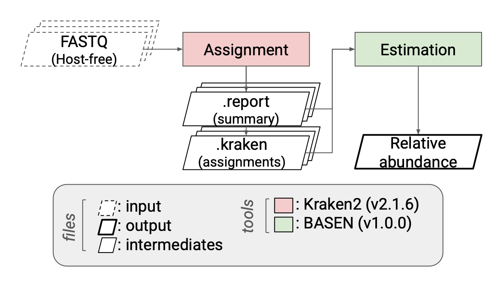

# Taxonomic Classification
> Read-level taxonomic assignment and abundance profiling using a custom Kraken2 database

## Rationale
Accurate taxonomic profiling of the long-read metagenomic data requires both high-quality reads and context-aware reference databases. Long-read sequencing introduces higher base error rates, and naïve classification against large, generic databases can lead to ambiguous assignments and inflated false positives.

This module ensures robust and reproducible estimation of microbial composition and engraftment dynamics:
  * Reduces misclassification caused by sequencing errors
  * Eliminates spurious taxa absent from the biological system
  * Improves abundance estimation accuracy
  * Enhances interpretability in engraftment and colonization studies

## Workflows

1. **Input**: Filtered, host-free reads from the [Preprocessing](./Preprocessing.md) module (Steps 09–10)
2. **Taxonomic classification**: Assign reads using Kraken2 with a custom database
3. **Confidence filtering**: Retain only high-confidence read assignments
4. **Quantification**: Estimate species-level relative abundance with **BASEN v1.0.0**

### Environment setup
Set the following environment variables to define input data, outputs, and database locations.

```bash
# Define base folders
export HOSTFREE_FOLDER=/path/to/hostfree        # Filtered, host-free reads (Preprocessing Step 10)
export CLASSIFICATION_FOLDER=/path/to/kraken2
export FILTERED_KRAKEN_FOLDER=/path/to/kraken2_filtered
export CUSTOMDB_FOLDER=/path/to/custom_db
export PROFILE_FOLDER=/path/to/basen
```

### Dependencies

Install or load the following tools prior to execution:

| Tool | Version | Purpose | Reference |
|------|---------|----------|------------|
| [Kraken2](https://github.com/DerrickWood/kraken2) | 2.1.6 | High-throughput taxonomic classification of sequencing reads | Wood et al. |
| [BASEN](https://github.com/Snyder-Institute/BASEN) | **v1.0.0** | Base-level Abundance estimation with Species-assigned Evidence using Nanopore | _Not published_ |

> **BASEN version.** All commands and results here use **BASEN v1.0.0** (GitHub commit `fad69ed`), in which the effective genome length is Gₛ = L − k + 1 (L = genome length in bp, k = 35). Check the installed version before running: `Rscript -e 'packageVersion("basen")'` should return `1.0.0`.

Kraken2 and BASEN have no random-seed option; Kraken2 classification is deterministic.

### Example directory structure
```bash
├── hostfree/               # Filtered, host-free reads (input)
├── kraken2/                # Kraken2 outputs: <sample>.kraken, <sample>.report
├── kraken2_filtered/       # Read-level k-mer profiles, excluded read IDs, filtered .kraken files
├── custom_db/              # Custom Kraken2 database and genome_stats.txt
└── basen/                  # Relative abundance profiles
```

### Schematic overview



### Pipeline steps
#### Step 01. Input reads
Reads are filtered by length and host reads are removed in the [Preprocessing](./Preprocessing.md) module (Steps 09–10). Classifying reads that still contain host sequences inflates the unclassified fraction and lets host reads compete for _k_-mer assignments.

#### Step 02. Taxonomic classification with Kraken2

Host-free reads are classified against the custom Kraken2 database generated from donor-derived MAGs (see [HMAcustomDB](./HMAcustomDB.md)).

```bash
k2 classify \
  --db $CUSTOMDB_FOLDER/myDB \
  --threads 16 \
  --report $CLASSIFICATION_FOLDER/F0.report \
  --output $CLASSIFICATION_FOLDER/F0.kraken \
  $HOSTFREE_FOLDER/F0.fastq.gz
```

#### Step 03. Confidence-based read filtering

We evaluated taxonomic classification accuracy using a defined positive control dataset, OMM12 (oligo-mouse microbiota), through comparative benchmarking of Kraken2 and Minimap2 coupled with CoverM. Each method was tested against two custom reference databases: (i) OMM12 alone and (ii) OMM12 augmented with decoy genomes (e.g., the human reference genome).

This benchmarking revealed two key patterns. First, Kraken2 produced more reliable taxonomic assignments than Minimap2 when validated against BLAST results. This discrepancy is likely attributable to Minimap2’s reliance on minimizers as alignment anchors; loss of these anchors can disrupt chaining and result in missed alignments, particularly in repetitive genomic regions. Second, we conducted _k_-mer–level profiling using Kraken2’s default _k_ value (_k_ = 35) and observed that the number of _k_-mers assigned to decoy genomes increased significantly when the proportion of unclassified reads was high. This suggests that unclassified reads may compete with dominant species for _k_-mer assignments.

To quantify this effect, we applied the Shannon diversity index at the read level, treating each read as a discrete distribution of _k_-mers across assignment categories (i.e., assigned to a specific reference genome versus unassigned). This formulation enables direct comparison of the relative abundance of assigned and unassigned _k_-mers within individual reads.

A classified read is excluded if **either** of the following holds:
  1. more than 75% of its _k_-mers are unassigned (unassigned proportion > 0.75); **or**
  2. its Shannon diversity index exceeds 1.0 in high-depth donor samples, or 0.75 in mouse samples, donor replicates and controls.

Unclassified reads are removed as well. The code below computes the read-level _k_-mer profile and the list of reads to exclude.

```R
# The following section provides an R script implementing this procedure
library(basen) # BASEN v1.0.0, https://github.com/Snyder-Institute/BASEN
library(dplyr)
stopifnot(packageVersion("basen") == "1.0.0")

shannon_diversity <- function(x) {
        x <- x[x > 0 & !is.na(x)]
        p <- x / sum(x)
        H <- -sum(p * log(p))

        return(H)
}

krakenFile <- "/path/to/kraken2/F0.kraken"
kraken <- read.table(krakenFile, header = FALSE, stringsAsFactor = FALSE, sep = "\t")
colnames(kraken) <- c("status", "read_id", "taxid", "read_length", "kmer_string")

buff <- kraken %>% filter(status == "C") %>% rowwise() %>% 
        dplyr::mutate(
                total_kmers = read_length - 35 + 1, 
                assigned_kmers = basen:::extract_kmer_counts(kmer_string, taxid), 
                unassigned_kmers = basen:::extract_kmer_counts(kmer_string, "0"), 
                kmers_diversity = shannon_diversity(basen:::extract_kmer_counts(kmer_string))
        ) %>%
        dplyr::ungroup() %>% select(read_id, total_kmers, assigned_kmers, unassigned_kmers, kmers_diversity)

kmer_profile <- buff %>% dplyr::mutate(
        assigned_perc = assigned_kmers / total_kmers, 
        unassigned_perc = unassigned_kmers / total_kmers
)

max_shannon <- 1.0 # high-depth donor sample; use 0.75 for mouse samples, donor replicates and controls
reads2exclude <- kmer_profile$read_id[kmer_profile$unassigned_perc > 0.75 | kmer_profile$kmers_diversity > max_shannon]

write.table(reads2exclude, "/path/to/kraken2_filtered/F0_read2exclude.txt", row.names=FALSE, col.names=FALSE, quote=FALSE)
```

The excluded and unclassified reads are then removed from the `.kraken` file. The output is written to a separate folder: redirecting into the input file would empty it before it is read.

```bash
kraken_file="$CLASSIFICATION_FOLDER/F0.kraken"
exclude_file="$FILTERED_KRAKEN_FOLDER/F0_read2exclude.txt"

awk '
  NR==FNR { ids[$1]=1; next }
  ($1 != "U" && !($2 in ids)) { print }
' "${exclude_file}" "${kraken_file}" > "$FILTERED_KRAKEN_FOLDER/F0.kraken"
```

#### Step 04. Quantification and abundance estimation with BASEN v1.0.0
Bracken is based on a Bayesian framework and requires a fixed read length as a prior, which makes it suboptimal for long-read sequencing data. To address this limitation, we developed a _k_-mer–based approach for estimating relative abundance, termed BASEN (Base-level Abundance estimation with Species-assigned Evidence using Nanopore).

BASEN estimates species-level relative abundance from long-read metagenomic data by restricting classification to species-level assignments and counting only species-assigned _k_-mers as base-level evidence. For each species s, the evidence Bₛ (species-assigned _k_-mers summed over the reads that passed Step 03) is divided by the effective genome length Gₛ = L − k + 1, giving a coverage proxy Cₛ = Bₛ / Gₛ. Within each sample, the coverage proxies are scaled to sum to 1: RAₛ = Cₛ / ΣᵢCᵢ.

The code below computes relative abundance with BASEN v1.0.0. It requires three inputs: (i) the `.report` files from Step 02, (ii) the filtered `.kraken` files from Step 03, and (iii) `genome_stats.txt` from the database build. The `.report` and `.kraken` files must be named `<sample>.report` and `<sample>.kraken`.

```R
# The following section provides an R script implementing this procedure
library(basen) # BASEN v1.0.0
stopifnot(packageVersion("basen") == "1.0.0")
resultsL <- kraken_relative_abundance(
        report_dir = "/path/to/kraken2",                        # <sample>.report (Step 02)
        kraken_dir = "/path/to/kraken2_filtered",               # <sample>.kraken (Step 03)
        k_mer_length = 35,
        genome_stats_file = "/path/to/custom_db/genome_stats.txt",
        sample_ids = "F0",
        output_folder = "/path/to/basen"
)
```

---
